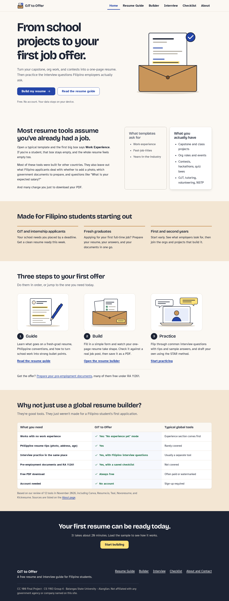

# OJT to Offer

**A free resume and interview guide for Filipino students.** Turn school projects and org work into a one-page resume, practice the interview questions local employers actually ask, and prepare your pre-employment documents, including the ones that are free under RA 11261.

**Live site:** https://princejorick.github.io/itc-final-project/

CC 100 Introduction to Computing Final Project · CS 1103 Group 4 · Batangas State University – Alangilan, College of Informatics and Computing Sciences · 1st Semester AY 2026–2027
Category 12: Employment and Career Services → Resume and Interview Guide



## The problem and our answer

Global tools like Canva, Resume.io, and Teal assume you already have work experience, often charge to download a PDF, keep resume-building separate from interview prep, and skip Philippine hiring realities. We reviewed 12 tools; see [docs/COMPETITORS.md](docs/COMPETITORS.md).

**UVP:** OJT to Offer helps Filipino students turn school projects and org work into a one-page resume, then practice the interview questions local employers actually ask, free, with no sign-up.

## Title

**OJT to Offer** names the exact path we help with, from your OJT or first application to your first job offer, using a word every Filipino college student already knows.

The name is stored in one place: `SITE_NAME` in [`site/js/data.js`](site/js/data.js). `nav.js` copies it into every page title and every element marked `data-site-name`. (The HTML also contains the name as plain text so it still shows if JavaScript is off; search-and-replace "OJT to Offer" in `site/*.html` if you rename.)

### Search evidence (November 10, 2026)

Five candidates were searched as exact phrases together with "resume," "career," and "interview."

| Candidate | Result | Decision |
|-----------|--------|----------|
| **OJT to Offer** | Searches for `"OJT to Offer" resume career interview`, `"OJT to Offer" career`, and `"OJTtoOffer" OR "OJT2Offer"` returned no product, company, or app with this name, only general on-the-job-training pages. | **Chosen** |
| Paper to Panel | No product found; closest match was an unrelated slide deck titled "From Paper to Performance." Doesn't say "student." | Rejected (weaker fit) |
| FirstRung | No product found for `"FirstRung"` or `"First Rung"` with resume/career/interview. Abstract; doesn't mention resume or interview. | Rejected (weaker fit) |
| Hire Ground | No exact match, but results were crowded with similarly named "Hire-" apps (Hired AI, Hireable, HireMind, Hiration). | Rejected (crowded) |
| Campus to Career | A common phrase already used by schools and career events (e.g., Mapúa MCM's "From Classroom to Career"). | Rejected (generic) |

## How to run

No install, no build. Either:

- **Offline:** open `site/index.html` in any modern browser (double-click it). Everything works from `file://`; without internet, the system fonts take over.
- **Online:** visit https://princejorick.github.io/itc-final-project/. GitHub Actions ([`.github/workflows/pages.yml`](.github/workflows/pages.yml)) publishes the `site/` folder as-is on every push to `main`.

For submission, zip or upload the `site/` folder to Google Drive.

## Features

| Page | What you can do |
|------|-----------------|
| **Home** | See the problem, who it's for, the Guide → Build → Practice journey, and a comparison with global tools |
| **Resume Guide** | Learn each resume section, Philippine conventions (photo, age and RA 10911, address, one page), dos and don'ts, weak vs strong bullets, and what to include with no experience |
| **Builder** | Fill in a form and watch a live preview; add/remove entries; "No experience yet" mode; Classic and Modern ATS-friendly templates; autosave (`localStorage`, key `resumeDraft`); load sample; clear with confirmation; Download PDF (one page, print-only layout) |
| | **Bullet helper** (rule-based): verb + what + tool + result → "Developed X using Y, resulting in Z", inserted with one click |
| | **Job-fit checker**: paste a posting → matched skills, missing skills, match %, and tips (case-insensitive, whole-word matching against 90+ keywords) |
| **Interview** | Flashcards with category filters, reveal tip and sample answer, previous/next, random question; 22 questions including "Expected salary?" and night shift; saved STAR template; attire and online interview tips |
| **Checklist** | 13 pre-employment documents with saved checkboxes, a progress bar, "How to get it" steps, and RA 11261 free-document guide |
| **About** | Mission, team, sources and credits, and a demo contact form with validation (nothing is sent) |

Accessibility: skip link, keyboard-friendly navigation, visible focus everywhere, labels on every input, WCAG AA contrast, and reduced-motion support.

## Project structure

```
site/                 ← the website (this is what gets submitted)
  index.html  resume-guide.html  builder.html  interview.html  checklist.html  about.html
  css/style.css       ← the one shared stylesheet
  css/print.css       ← resume-only print layout
  js/data.js          ← all content data + SITE_NAME
  js/nav.js  js/builder.js  js/interview.js  js/checklist.js  js/contact.js
  images/             ← original SVGs
docs/                 ← research, design system, team notes, screenshots, inputs
tests/                ← Playwright tests (dev only; the site never uses this folder)
SOURCES.md  CHANGELOG.md  PRODUCT.md
```

## Testing

Playwright runs every page and feature at 375px and 1280px against the site opened from the file system.

```bash
cd tests
npm install
npx playwright install chromium
npm test                 # 166 passing, 2 skipped (mobile-only / desktop-only checks)
npm run screenshots      # refreshes docs/screenshots/
```

## Tech and skills used

- **Stack:** HTML5, one CSS file (custom properties, Flexbox, Grid, media queries), vanilla JavaScript, `localStorage`. No frameworks, libraries, build tools, backend, or third-party services. Google Fonts is the only external request.
- **Design and build skills:** ui-ux-pro-max (design system generation), impeccable (product context, design direction, craft checks, contrast hook), web research for competitors, title checks, and PH government facts; Playwright for testing and screenshots.

## Documentation for the team

- [docs/DOCS-NOTES.md](docs/DOCS-NOTES.md): storyboard, wireframes, theme details, 5-minute demo script, Q&A notes
- [docs/TEAM-ROLES.md](docs/TEAM-ROLES.md): roles and page ownership (**three roles still need team confirmation**)
- [docs/DESIGN.md](docs/DESIGN.md): design system and the reason for each choice
- [docs/COMPETITORS.md](docs/COMPETITORS.md): competitor research, gaps, UVP, differentiators
- [docs/inputs/](docs/inputs/): the original build prompt and planning summary. Add the official guidelines, rubric, and template PDFs here. **Do not add the class groupings spreadsheet or other students' details.**

## Credits

- Content sources: see [SOURCES.md](SOURCES.md) and the About page.
- Fonts: Bricolage Grotesque and Atkinson Hyperlegible (Google Fonts, SIL Open Font License).
- Illustrations, logo, and icons: original work for this project.
- Team: Prince Jorick Fajutagana, Alloysia Mae, Elise Guerra, Sherwin Dollente Jr.

Not affiliated with any government agency or company named on this site. Fees and procedures change, so always confirm with the agency.
