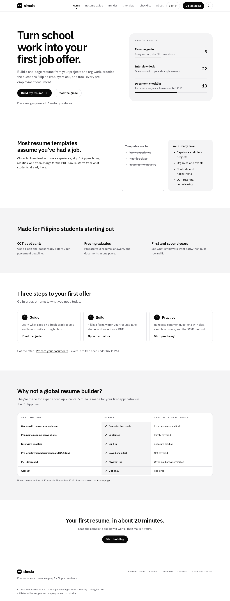
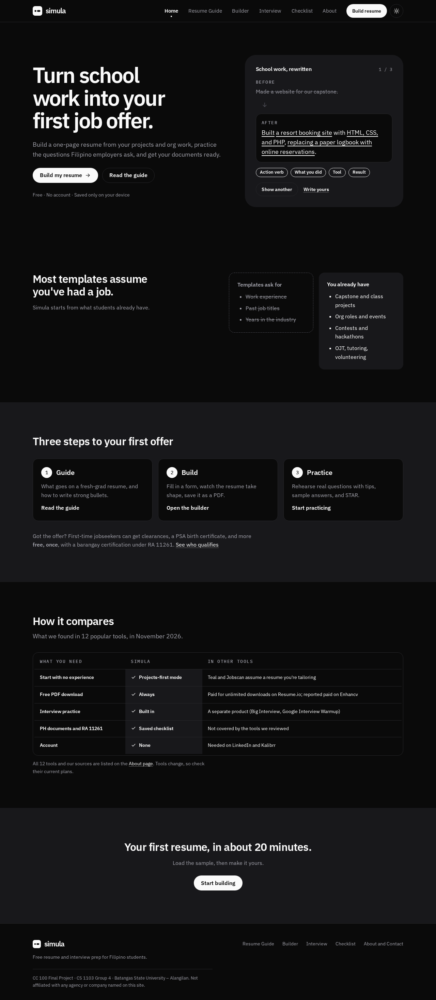

# Simula

**A free resume and interview guide for Filipino students.** Turn school projects and org work into a one-page resume, practice the interview questions local employers actually ask, and prepare your pre-employment documents, including the ones that are free under RA 11261.

**Live site:** https://simula-itc.vercel.app

CC 100 Introduction to Computing Final Project · CS 1103 Group 4 · Batangas State University – Alangilan, College of Informatics and Computing Sciences · 1st Semester AY 2026–2027
Category 12: Employment and Career Services → Resume and Interview Guide





## The problem and our answer

Global tools like Canva, Resume.io, and Teal assume you already have work experience, often charge to download a PDF, keep resume-building separate from interview prep, and skip Philippine hiring realities. We reviewed 12 tools; see [docs/COMPETITORS.md](docs/COMPETITORS.md).

**UVP:** Simula helps Filipino students turn school projects and org work into a one-page resume, then practice the interview questions local employers actually ask, free, with an optional account that nobody has to make.

## Title

**Simula** is the Filipino word for "beginning," and that is exactly what this site is for: the first resume, the first interview, the first offer. A student reads it as their own starting point, and it stays one word, five letters, easy to say in a class demo.

The name is stored in one place: `SITE_NAME` in [`site/js/data.js`](site/js/data.js). `nav.js` copies it into every page title and every element marked `data-site-name`. (The HTML also contains the name as plain text so it still shows if JavaScript is off; search-and-replace "Simula" in `site/*.html` if you rename.)

### Name check (November 10, 2026)

Live web search was unavailable in this session, so the record here is what we can state from general knowledge. The one well-known namesake is **Simula**, the 1960s Norwegian programming language credited as the first object-oriented language; it is of historical interest only, not a product, company, or app in the career space, and for a Computer Science project the nod reads as intentional rather than accidental. No resume, career, or interview product named Simula is known to the team. The name decision was confirmed by the team during the redesign.

## How to run

No install, no build. Either:

- **Offline:** open `site/index.html` in any modern browser (double-click it). Everything works from `file://`; without internet, the system fonts take over, and signing in is simply not available (see Accounts below).
- **Online:** visit https://simula-itc.vercel.app. Vercel serves the `site/` folder as-is ([`vercel.json`](vercel.json), no build step) and redeploys on every push to `main`.

For submission, zip or upload the `site/` folder to Google Drive.

## Your data

There are no accounts. Drafts, custom interview cards, the STAR draft, and checklist progress live in `localStorage` in the visitor's own browser; nothing is sent anywhere. Because clearing browser data would erase them, the builder and About pages offer **Download backup**, **Restore**, and (on About) **Delete everything**. The About page also has a short privacy notice that mentions the Data Privacy Act (RA 10173).

## Features

| Page | What you can do |
|------|-----------------|
| **Home** | A live "School work, rewritten" demo (a weak line becomes a strong bullet, part by part), the problem, the Guide → Build → Practice journey, the RA 11261 conditions in one line, and a comparison that names the tools |
| **Resume Guide** | Learn each resume section, Philippine conventions (photo, age and RA 10911, address, one page), dos and don'ts, weak vs strong bullets, what to include with no experience, a cover letter outline with an example, and where to apply (job sites, PESO, job fairs, school, company sites) |
| **Builder** | Fill in a form and watch a live preview; add/remove entries; "No experience yet" mode; Classic and Modern ATS-friendly templates; autosave (`localStorage`, key `resumeDraft`); load sample; clear with confirmation; Download PDF (one page, print-only layout); backup and restore; a "See preview" shortcut on phones and tablets |
| | **Bullet helper** (rule-based): verb + what + tool + result → "Developed X using Y, resulting in Z", inserted with one click |
| | **Job-fit checker**: paste a posting → matched skills, missing skills, match %, and tips (case-insensitive, whole-word matching against 90+ keywords) |
| **Interview** | Flashcards with category filters (including a "Yours" shelf), reveal tip and sample answer, previous/next, random question; 23 built-in questions (including salary, night shift, and relocation); **write, edit, and delete your own cards** (saved as `simulaCards` on the device); saved STAR template; questions to plan for; online and technical interview prep; attire; thank-you and follow-up email templates with Copy buttons |
| **Checklist** | 13 pre-employment documents with saved checkboxes, a progress bar, "How to get it" steps, and an RA 11261 guide that spells out who qualifies, what's free, and "verify with your barangay or PESO" |
| **About** | Mission, team, privacy and your data (download, restore, delete), sources including the 12 compared tools, and a demo contact form with validation (nothing is sent) |

Accessibility: skip link, keyboard-friendly navigation, visible focus everywhere, labels on every input, WCAG AA contrast in light and dark mode, and reduced-motion support.

Look and themes: a monochrome design (ink on white, flipped for dark mode) with rounded shapes and IBM Plex Sans and Mono. The site follows the device's light or dark setting; the round button in the header switches it by hand and remembers the choice. The logo and the three illustrations switch with the theme. The resume preview always stays black on white, because it prints.

## Project structure

```
site/                 ← the website (this is what gets submitted)
  index.html  resume-guide.html  builder.html  interview.html
  checklist.html  about.html
  css/style.css       ← the one shared stylesheet
  css/print.css       ← resume-only print layout
  js/data.js          ← all content data + SITE_NAME
  js/nav.js           ← shared header/menu behavior, theme switch, illustration swap
  js/motion.js        ← scroll reveals (sections rise in after the first screen)
  js/scroll.js        ← eased wheel scrolling (reduce motion turns it off)
  js/home.js          ← the hero's before/after bullet demo
  js/backup.js        ← download, restore, or delete saved data
  js/builder.js  js/interview.js  js/checklist.js  js/contact.js
  images/             ← original SVGs: favicon, plus light/ and dark/ sets of the logo and illustrations
docs/                 ← research, design system, team notes, screenshots, inputs
tests/                ← Playwright tests (dev only; the site never uses this folder)
SOURCES.md  CHANGELOG.md  PRODUCT.md
```

## Testing

Playwright runs every page and feature at 375px and 1280px against the site opened from the file system. `theme.spec.js` also checks every page in light and dark mode (matching illustrations, the manual toggle, the favicon, and black-on-white print).

```bash
cd tests
npm install
npx playwright install chromium
npm test                 # 233 passing; 27 skipped (24 opt-in screenshots + 3 viewport-only checks)
npm run screenshots      # refreshes docs/screenshots/ (every page, desktop and mobile, light and dark)
```

## Tech and skills used

- **Stack:** HTML5, one CSS file (custom properties, Flexbox, Grid, media queries), vanilla JavaScript, `localStorage`. No frameworks, build tools, or backend. Google Fonts is the only external request the site makes.
- **Design and build skills:** ui-ux-pro-max (design system generation), impeccable (product context, design direction, craft checks, contrast hook, finish review), web research for competitors, title checks, and PH government facts; Playwright for testing and screenshots.
- **Visual direction (v1.2.0, mono):** seven monochrome color tokens that flip for dark mode, ink pill buttons, 16px cards and 24-32px panels, IBM Plex Sans and Mono, original rounded mono illustrations, and a dot-and-pill mark that inverts with the theme. Full detail in [docs/DESIGN.md](docs/DESIGN.md).

## Documentation for the team

- [docs/DOCS-NOTES.md](docs/DOCS-NOTES.md): storyboard, wireframes, theme details, 5-minute demo script, Q&A notes
- [docs/TEAM-ROLES.md](docs/TEAM-ROLES.md): team members and the developer's role
- [docs/DESIGN.md](docs/DESIGN.md): design system and the reason for each choice
- [docs/COMPETITORS.md](docs/COMPETITORS.md): competitor research, gaps, UVP, differentiators
- [docs/inputs/](docs/inputs/): the original build prompt and planning summary. Add the official guidelines, rubric, and template PDFs here. **Do not add the class groupings spreadsheet or other students' details.**

## Credits

- Content sources: see [SOURCES.md](SOURCES.md) and the About page.
- Fonts: IBM Plex Sans and IBM Plex Mono (Google Fonts, SIL Open Font License).
- Logo, favicon, illustrations, and icons: original assets made by the team for this project, created with Claude (mono set). No stock images.
- Team: Prince Jorick C. Fajutagana, Alloysia Mae M. Lugue, Dazel Elise L. Guerra, Sherwin J. Dollente Jr.

Not affiliated with any government agency or company named on this site. Fees and procedures change, so always confirm with the agency.
